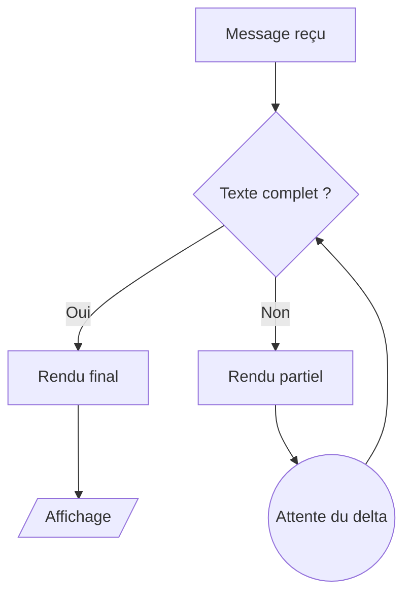
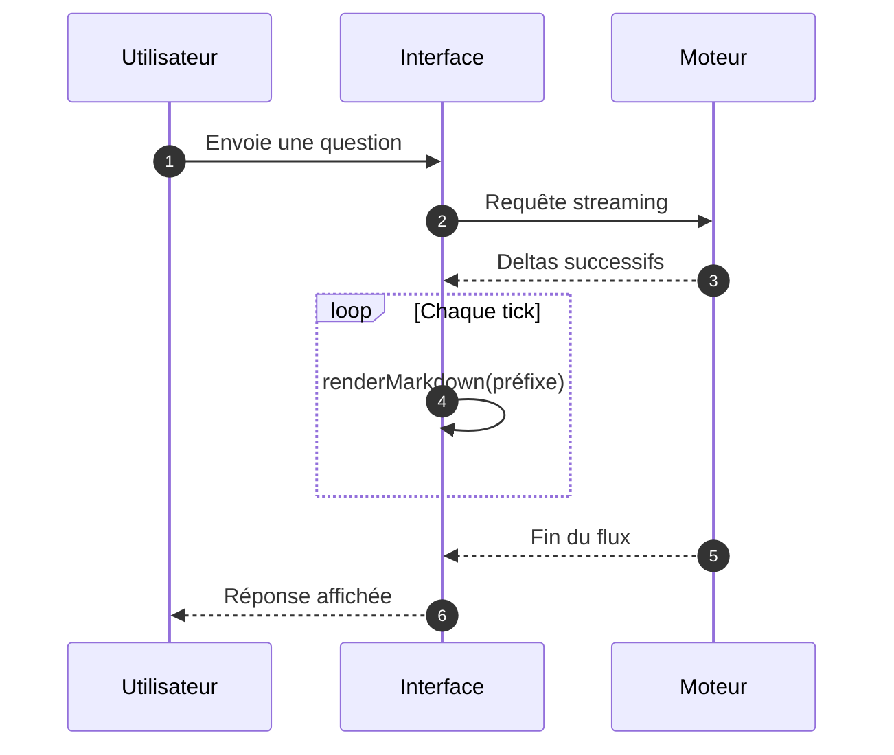

# Diagrammes (exemple)

Flux de validation :



Échange entre services :



Diagramme invalide (syntaxe cassée, doit échouer proprement) :

```mermaid
flowchart LR
    A --> --> B[[
    subgraph
```
